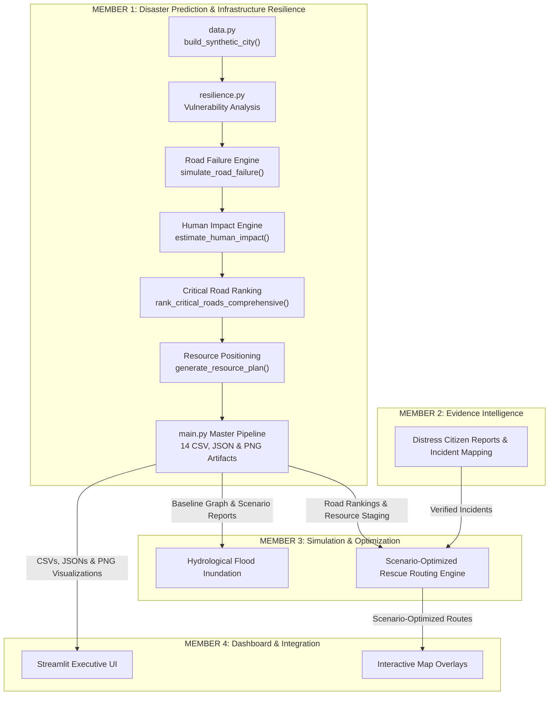

# SANJEEVANI — Member 1 Technical Documentation
## Module: Disaster Prediction & Infrastructure Resilience

> **Project Title:** SANJEEVANI — Human-Centric Disaster Intelligence, Infrastructure Resilience & Autonomous Emergency Response Network  
> **Tagline:** Predict the failure. Protect the connection. Save the response time.  
> **Author/Owner:** Member 1 (Disaster Prediction & Infrastructure Resilience)  
> **Environment:** Python 3.12 (64-bit), Windows 11, NetworkX, Pandas, NumPy, Matplotlib, Pytest  
> **Prototype Scope Notice:** While the overarching hackathon concept title includes "Autonomous Emergency Response Network", Member 1's implemented module is strictly an **explainable, deterministic, scenario-based decision-support prototype** operating on synthetic municipal data. It does not perform live sensor monitoring, real-time flood prediction, or autonomous vehicle dispatch.

---

## 1. Module Purpose and Responsibilities

Member 1 serves as the **foundational infrastructure and physical vulnerability layer** for the four-member SANJEEVANI disaster-management decision-support system. 

### Core Responsibilities:
1. **Synthetic City Infrastructure Model:** Define, construct, and serialize a connected urban road network consisting of residential communities, tertiary trauma and general hospitals, evacuation shelters, emergency response staging bases, and road junctions.
2. **Topological Fragility & Vulnerability Analysis:** Compute explainable graph metrics, including weighted edge betweenness centrality (using `travel_time_min` as edge weights across shortest paths) and biconnected component cut-edges (graph bridges).
3. **Non-Destructive Failure Simulation:** Model single-road collapses and multi-bridge compound flood disruptions without mutating the underlying ground-truth city network.
4. **Human Life Impact & Medical Delay Quantification:** Measure civilian populations losing hospital and shelter reachability with strict non-double-counting set unions, while quantifying emergency transit detour minutes for connected populations.
5. **Three-Dimensional Critical Road Ranking:** Synthesize physical hazard probability, network betweenness, acute access-loss risk, and medical delay impact into an explainable multi-criteria priority ranking.
6. **Pre-Disaster Resource Positioning:** Generate explainable heuristic staging recommendations for emergency ambulances, amphibious rescue boats, first-responder teams, and food/water supplies before severe weather hits.
7. **Structured Artifact Generation:** Export production-grade JSON models, CSV tables, and high-resolution PNG cartographic maps for consumption by Member 3 (Simulation & Rescue Routing) and Member 4 (Streamlit Dashboard).

---

## 2. System Architecture

SANJEEVANI operates on a closed-loop human-centric operational paradigm:
$$\text{OBSERVE} \longrightarrow \text{ESTIMATE} \longrightarrow \text{SIMULATE} \longrightarrow \text{OPTIMIZE} \longrightarrow \text{VERIFY} \longrightarrow \text{REPEAT}$$



---

## 3. Synthetic City Data Model

The synthetic city represents a medium-sized river valley municipality divided into distinct quadrants by a natural watercourse.

> [!IMPORTANT]
> **Coordinate Semantics (Synthetic 2D Grid, Not GPS):**  
> All node coordinates `pos: (x, y)` and DataFrame columns `pos_x`, `pos_y` are **synthetic 2D integer Cartesian grid coordinates** on an arbitrary 100×100 layout canvas designed specifically for schematic graph visualization with NetworkX and Matplotlib.  
> They are **NOT** geographic GPS coordinates (latitude/longitude) or projected GIS coordinates. External geocoding, spherical Haversine formulas, and geographic map tile layers must not be used.

### Nodes (16 Total):
- **Residential Zones (6 nodes, 90,000 total population):**
  - `R1`: "Riverside Colony" (pop: 14,000, high flood exposure, coords: `(15, 40)`)
  - `R2`: "Downtown Heights" (pop: 28,000, medium flood exposure, dense core, coords: `(45, 60)`)
  - `R3`: "Hilltop Suburb" (pop: 9,500, low flood exposure, single access road, coords: `(20, 85)`)
  - `R4`: "East End Ward" (pop: 18,000, medium flood exposure, coords: `(85, 45)`)
  - `R5`: "Old Town Quarter" (pop: 12,500, high flood exposure, historic riverbank, coords: `(60, 25)`)
  - `R6`: "Lakeside Enclave" (pop: 8,000, high flood exposure, lake shore, coords: `(30, 15)`)
- **Critical Hospitals (2 nodes, 700 total beds):**
  - `H1`: "City General Hospital" (capacity: 450 beds, inpatient medical center, coords: `(50, 75)`)
  - `H2`: "Apex Trauma Center" (capacity: 250 beds, specialized trauma center, coords: `(80, 20)`)
- **Emergency Evacuation Shelters (2 nodes, 5,500 total capacity):**
  - `S1`: "North Community Stadium Shelter" (capacity: 3,500 evacuees, coords: `(35, 90)`)
  - `S2`: "East High School Civic Camp" (capacity: 2,000 evacuees, coords: `(70, 70)`)
- **Emergency Response Staging Bases (2 nodes, 35 vehicles):**
  - `E1`: "Central Fire & EMS Hub" (fleet: 20 vehicles, coords: `(40, 50)`)
  - `E2`: "Westside Rescue Depot" (fleet: 15 vehicles, river embankment launch, coords: `(10, 60)`)
- **Junctions (4 nodes):**
  - `J1`: "Central Circle Junction" (coords: `(35, 45)`)
  - `J2`: "River Crossing Bridgehead" (coords: `(55, 45)`)
  - `J3`: "East Arterial Junction" (coords: `(75, 55)`)
  - `J4`: "North Ridge Junction" (coords: `(25, 75)`)

### Edges (20 Roads & Bridges):
- Categorized into `bridge` (3 physical structures across water), `highway` (3 high-speed expressway segments), `arterial` (8 primary thoroughfares), and `local` (6 access streets).
- Attributes: `road_id`, `source`, `destination`, `name`, `distance_km`, `travel_time_min`, `failure_probability` ($[0.0, 1.0]$), `flood_sensitivity` ($[0.0, 1.0]$), and `is_available` (boolean).

---

## 4. Graph Representation Using NetworkX

The city is modeled as an undirected NetworkX graph:
```python
G = nx.Graph()
```
An undirected graph is utilized because municipal traffic and emergency response vehicles flow in both directions under pre-disaster conditions. Directional lane reversals during evacuations can be layered dynamically as subgraphs.

Every node and edge carries serializable Python native datatypes (`int`, `float`, `str`, `bool`, `tuple[int, int]`). Edge traversal weights are configured to `travel_time_min` rather than geometric distance alone, ensuring that weighted shortest-path calculations reflect realistic emergency vehicle transit durations.

---

## 5. Infrastructure Vulnerability Analysis

Before simulating disasters, the baseline vulnerability of each road segment is evaluated using an explainable linear combination of physical hazards and structural network centrality:

$$S_{\text{infra}} = 0.35 \cdot P_{\text{fail}} + 0.25 \cdot \text{FloodSens} + 0.25 \cdot \min(2.5 \cdot \text{EBC}, 1.0) + (0.15 \text{ if Cut-Edge})$$

- **$P_{\text{fail}}$ (Weight: 0.35):** Inherent physical or historical structural failure probability.
- **$\text{FloodSens}$ (Weight: 0.25):** Geological and elevation exposure to rising water levels.
- **$\text{EBC}$ (Weight: 0.25):** Normalized edge betweenness centrality scaled by $2.5$.
- **Cut-Edge Bonus (Weight: 0.15):** Added if the road is a topological single point of failure.

---

## 6. Graph-Theoretic Cut-Edges vs. Physical Bridges

A fundamental software architecture distinction implemented in this module is separating **civil engineering physical bridges** from **graph-theoretic bridges (cut-edges)**:

| Concept | Civil Engineering Physical Bridge | Graph-Theoretic Cut-Edge |
| :--- | :--- | :--- |
| **Definition** | A physical civil structure spanning water or a valley (`road_type == 'bridge'`). | A topological edge whose removal strictly increases the number of connected components. |
| **Examples in City** | `RD11` (Grand River Bridge), `RD14` (East Crossway Bridge), `RD19` (South Bank Causeway Bridge). | `RD04` (Hilltop Access Road). |
| **Network Impact** | Highly vulnerable to flood surges, but alternative detours exist across the river. | Loss **instantly partitions** the city graph with **zero alternative routes**. |
| **Human Consequence**| Causes cross-river traffic detours. | Completely strands 9,500 residents of Hilltop Suburb (`R3`). |

---

## 7. Single-Road and Multiple-Road Failure Simulation

### Non-Destructive Graph Cloning
Simulations never mutate the original city graph $G$. Every scenario creates an independent copy:
```python
scenario_G = G.copy()
scenario_G.remove_edge(u, v)
```
Removing the edge from the scenario copy ensures that all native NetworkX traversal algorithms (`nx.has_path`, `nx.shortest_path_length`, `nx.connected_components`) naturally avoid the blocked segment without custom traversal overrides.

> [!NOTE]
> **Scenario Graph Hand-off Interface:**  
> - **In-Memory Python API:** `simulate_road_failure(G, road_id)` and `simulate_multiple_failures(G, road_ids)` return an independent cloned `nx.Graph` under the key `"scenario_graph"`. The original baseline graph `G` remains strictly unchanged (`is_original_graph_unchanged == True`).  
> - **On-Disk JSON Files:** In serialized files (`rd04_failure_scenario.json`, `rd11_failure_scenario.json`), `scenario_graph` is intentionally omitted because NetworkX graph instances cannot be directly serialized into JSON format.

### Service Isolation vs. Component Partitioning
Our engine distinguishes between a graph component split and actual service loss:
- If a compound flood severs all river crossings (`RD11`, `RD17`, `RD19`), the city splits into 2 components (West and East).
- **The Engine's Check:** It verifies path existence from each residential zone to **all** facilities of that type.
- Because West contains `H1` and `S1`, and East contains `H2` and `S2`, **neither half loses hospital or shelter access**. Residents are only flagged as disconnected if their component lacks that specific facility.

---

## 8. Human Impact Estimation

### Strict Non-Double-Counting
To eliminate population inflation, human impact calculations use mathematical set unions across affected residential zones:
$$\text{Unique Impacted Population} = \sum_{z \in (\text{Zones}_{\text{no\_hospital}} \cup \text{Zones}_{\text{no\_shelter}})} \text{Population}(z)$$

If `RD04` collapses:
- Population without hospital reach: $9,500$
- Population without shelter reach: $9,500$
- **Total Unique Affected Population:** **$9,500$** (NOT $19,000$).

### Emergency Medical Delay Quantification
For populations that remain connected, the engine computes detour delays compared to pre-disaster baselines:
$$\Delta t = t_{\text{scenario}} - t_{\text{baseline}}$$
For example, when `RD10 (Downtown Hospital Expressway)` fails, 42,000 citizens in `R1` and `R2` experience hospital response detours up to **$+14.9$ minutes**.

---

## 9. Comprehensive Critical-Road Ranking Formula

To eliminate the "Harmless Delay Trap" (where roads causing massive travel delays receive zero risk because no one is 100% cut off), the module implements a **Three-Dimensional Multi-Criteria Decision Analysis (MCDA) Peak-Blend formula**.

> [!NOTE]
> **Prototype Parameter Disclaimer:**  
> All weights ($0.35, 0.25, 0.55, 0.45, 0.60, 0.40$), scaling factors ($2.5$), and normalization benchmarks ($9,500$ residents, $42,000$ residents, $15.0$ minutes) are **explainable heuristic prototype parameters** calibrated for demonstration and decision-support testing, not certified civil engineering disaster metrics.

### The Three Independent Normalized Dimensions:
1. **Dimension A: Access-Loss Impact Score ($S_{\text{access}} \in [0.0, 1.0]$):**
   $$S_{\text{access}} = \min\left(\frac{\text{Unique Population Losing Access}}{9,500}, 1.0\right)$$
2. **Dimension B: Emergency Medical Delay Score ($S_{\text{delay}} \in [0.0, 1.0]$):**
   $$S_{\text{delay}} = 0.55 \cdot \min\left(\frac{\text{Population with Hospital Delay}}{42,000}, 1.0\right) + 0.45 \cdot \min\left(\frac{\text{Max Hospital Delay (min)}}{15.0}, 1.0\right)$$
3. **Dimension C: Infrastructure Vulnerability Score ($S_{\text{infra}} \in [0.0, 1.0]$):**
   $$S_{\text{infra}} = 0.35 \cdot P_{\text{fail}} + 0.25 \cdot \text{FloodSens} + 0.25 \cdot \min(2.5 \cdot \text{EBC}, 1.0) + (0.15 \text{ if Cut-Edge})$$

### The Peak-Blend Synthesis:
$$\text{Peak Threat} = \max(S_{\text{access}}, S_{\text{delay}}, S_{\text{infra}})$$
$$\text{Average Threat} = \frac{S_{\text{access}} + S_{\text{delay}} + S_{\text{infra}}}{3}$$
$$\text{Comprehensive Criticality Score} = 0.60 \cdot \text{Peak Threat} + 0.40 \cdot \text{Average Threat}$$

### Criticality Level Categorization:
- **`CRITICAL`:** Score $\ge 0.55$ or Graph Cut-Edge
- **`HIGH`:** $0.40 \le \text{Score} < 0.55$
- **`MODERATE`:** $0.25 \le \text{Score} < 0.40$
- **`LOW`:** $\text{Score} < 0.25$

---

## 10. Pre-Disaster Resource Positioning Heuristics

The engine pre-positions assets across 4 distinct emergency classes before severe weather strikes using explainable demand-capacity heuristics (prototype decision-support parameters):
1. **Ambulances (`ambulances`):** Staged at central dispatch `E1`, hospitals `H1` and `H2`, and dense core `R2`. Minimizes emergency response detours across 50,000 residents.
2. **Rescue Boats (`boats`):** Staged at riverbank depot `E2` and waterfront residential wards `R1` (Riverside) and `R6` (Lakeside).  
   *Assumption:* Prototype assumes local shoreline, dock, or ramp launching access for inflatable flood rescue boats.
3. **Rescue Teams (`rescue_teams`):** Staged across dual-quadrant response bases `E1` and `E2` and shelters `S1` and `S2` to ensure first responders are pre-deployed on both sides of the river before bridges collapse.
4. **Emergency Food & Water Supplies (`emergency_supplies`):**  
   - **#1 Priority:** `R3: Hilltop Suburb` (population 9,500). Because single road `RD04` is a cut-edge, supplies **must** be pre-positioned inside `R3` before the storm hits; external trucks cannot enter post-collapse.
   - **#2 & #3 Priorities:** Evacuation Shelters `S1` and `S2` (civilian staging).
   - **#4 Priority:** Waterfront Community `R1`.

---

## 11. Unified Pipeline Execution

The master pipeline is packaged in [`main.py`](file:///c:/Users/dell/Desktop/SANJIVANI/main.py) and executes the following sequence:
1. Constructs the NetworkX graph $G$.
2. Generates summary metrics (`city_summary.json`) and serializes the baseline network (`baseline_city_network.json`).
3. Computes betweenness centrality and identifies topological cut-edges (`RD04`).
4. Simulates Scenario A (`RD04` failure) and Scenario B (`RD11` failure).
5. Evaluates city-wide human impact across all 20 roads (`human_impact_results.csv`).
6. Computes comprehensive critical road ranking (`critical_road_ranking.csv` & `.json`).
7. Computes pre-disaster resource staging plan (`resource_positioning_plan.csv` & `.json`).
8. Generates 5 high-resolution PNG maps using headless Matplotlib (`Agg`).
9. Asserts strict baseline graph non-mutation.

---

## 12. Output Files and Schemas

All output artifacts are exported directly to `outputs/`:

| Output File | Primary Format | Schema Highlights |
| :--- | :---: | :--- |
| `city_summary.json` | JSON | `total_population`, `total_hospital_beds`, `total_shelter_capacity`, `bridges_count`. |
| `baseline_city_network.json` | JSON | Full node list with `(pos_x, pos_y)` coordinates and edge list with metrics. |
| `rd04_failure_scenario.json` | JSON | `failed_road_ids`, `connected_component_count: 2`, `disconnected_residential_zones: ["R3"]`. |
| `rd11_failure_scenario.json` | JSON | `failed_road_ids`, `connected_component_count: 1`, alternative route detours. |
| `human_impact_results.csv` | CSV | `road_id`, `name`, `pop_no_hospital`, `pop_no_shelter`, `unique_pop_lost_service`, `pop_hospital_delay`. |
| `critical_road_ranking.csv` | CSV | 19 columns: `road_id`, `road_name`, `road_type`, hazard probabilities, centrality, access loss, delay scores, `comprehensive_criticality_score`, `criticality_level`, `explanation`. |
| `resource_positioning_plan.csv`| CSV | `resource_type`, `recommended_node_id`, `recommended_location_name`, `confidence_or_suitability_score`, `relevant_population`. |
| 5 PNG Map Visualizations | PNG (150 DPI) | `viz_city_network.png`, `viz_critical_roads.png`, `viz_rd04_failure.png`, `viz_rd11_failure.png`, `viz_resource_plan.png`. |

---

## 13. Testing Strategy

The test suite in [`tests/test_resilience.py`](file:///c:/Users/dell/Desktop/SANJIVANI/tests/test_resilience.py) contains **42 automated Pytest tests** covering normal execution, edge cases, and integration contracts:
- **Tests 1–5:** Graph instance, 16 nodes, 20 edges, attributes, summary, DataFrame & JSON roundtrip.
- **Tests 6–9:** Betweenness centrality, cut-edge identification, vulnerability tables, graph non-mutation.
- **Tests 10–15:** Road failure simulation, invalid road IDs (`ValueError`), compound failures, service isolation vs partitioning, facility isolation.
- **Tests 16–20:** Baseline travel times, single-cut edge impact, non-double-counting assertions, hospital delays, all-roads evaluation.
- **Tests 21–23:** Ranked road structure, affected population arithmetic, file serialization.
- **Tests 24–27:** Comprehensive 19-column ranking, RD04 & RD10 evaluation, score normalization bounds $[0.0, 1.0]$, export files.
- **Tests 28–35:** Candidate filtering, invalid resource types, all 4 resource classes, cut-edge prioritization, degree-0 screening, plan export.
- **Tests 36–42:** Pipeline execution manifest, 14 output files existence, JSON validity, non-empty CSVs, scenario separation, PNG image file size checks ($> 50\text{ KB}$), idempotency.

---

## 14. Limitations and Scientific Assumptions

1. **Synthetic Data:** Topologies, ward populations, and bed numbers are synthetic representations designed for hackathon demonstration.
2. **Weather Calibration:** Road failure probabilities and flood sensitivities are normalized prototype scores ($[0.0, 1.0]$) rather than outputs of calibrated meteorological hydraulic simulations.
3. **Launch Ramp Assumptions:** Rescue boat staging recommendations assume local watercraft launching capability along identified waterfront nodes.
4. **Decision-Support Scope:** All outputs are designed to assist human emergency authorities and must never supersede official municipal emergency command directives.

